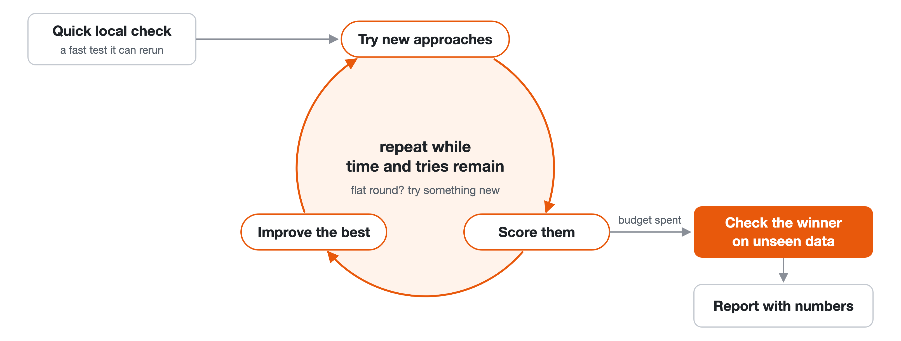

# anti-skill

<p align="center">
  <a href="CHANGELOG.md"></a>
  <a href="LICENSE"></a>
  <a href="#install"></a>
  
</p>

**No numbers, no done.**

Claude Code skills for the moment an agent says "done" too early. Ask for faster code and a plain
agent writes one good rewrite, times it once and stops. With anti-skill it measures, keeps
searching, and accepts only what holds up on data it never tuned against.

## evolve

For anything with a score: speed, a benchmark, a metric backed by tests. It keeps searching past
the first answer that works.



**The code it wrote was 23.4% faster than plain Claude Code's** on our speed benchmark, with the
same task, instructions and limits. Every evolve run beat every plain one. It is not just working
longer: against plain Claude Code told not to stop at the first answer, evolve was still 9.1% faster.
On a second task, a cache policy, plain Claude Code told to keep going did about as well.

It builds a quick local check, tries several different approaches, improves the best one in
rounds, and checks the winner on data it did not tune on. A run takes about 15 minutes; say
"quick" for about 5, or "take your time" for no limit.

Ask it like this:

- "Make this dedup function faster."
- "Get this scheduler's score up."
- "Find a better heuristic for this packing problem."

## profile-first

For a program that is slow when nobody knows why. It finds where the time really goes before
anyone rewrites anything.

**Its estimate of how much time the slowest part takes was 81% closer to the truth than plain
Claude Code's:** off by 1.5% of run time instead of 8.1%. On harder profiling tasks it did worse
than plain Claude Code on most measures, in a small test of 8 runs each.

It profiles an input of real size, confirms each hot spot by stubbing it out and timing the whole
run, and clears what only looks slow. It works on Python programs that run to completion, on macOS
and Linux. If evolve runs next in the same folder, it starts from the hot spot profile-first found.

Ask it like this:

- "Why is this import job slow?"
- "Make this report faster."
- "Where does startup time go?"

## Install

```
/plugin marketplace add bombsdontbite/anti-skill
/plugin install anti-skill@anti-skill
```


<details>
<summary>Copy the skills by hand</summary>

```
git clone https://github.com/bombsdontbite/anti-skill.git
cp -r anti-skill/plugins/anti-skill/skills/{evolve,profile-first} ~/.claude/skills/
```

Copied this way, they are called `/evolve` and `/profile-first`.

</details>

The profile-first scripts need Python 3.9 or later, on macOS or Linux.

## Use

Just ask, as in the examples above: the skills load on their own. If one does not, call it by name,
for example `/anti-skill:evolve`.

Both skills take longer and use more tokens than plain Claude Code. That is the point: the extra
time goes into measuring.

## Results and research

Every measurement, including the ties and the losses, and how each one was made, is in
[RESULTS.md](RESULTS.md). What others have built for the same problems, and what we took from it,
is in [the research notes](research/README.md).

How the skills were built: [the article on Medium](https://medium.com/@bombsdontbite/no-numbers-no-done-teaching-claude-code-not-to-stop-at-the-first-correct-answer-fb9b45e385e9).

## Coming next

Two more skills are in progress: **make-scorer**, a scorer that cannot be gamed, and
**bench-fairly**, speed comparisons that do not fool you. Each ships only after it beats plain
Claude Code on its own benchmark.

## License

MIT, see [LICENSE](LICENSE).
