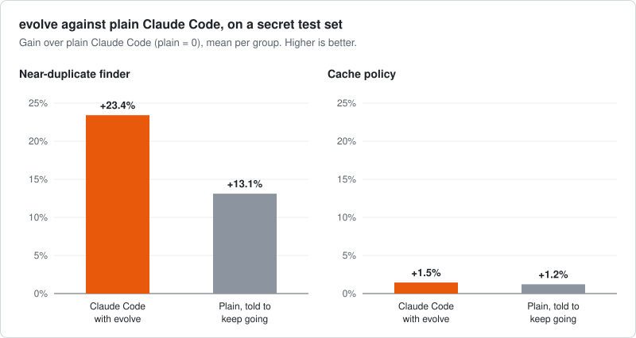

# Results

Every measurement behind the [README](README.md), wins, ties and losses alike. Each table compares
plain Claude Code with Claude Code using the skill, on the same task with the same instructions.

## evolve

| What was measured | Plain Claude Code | With the skill | Difference | Runs | Evidence |
|---|---|---|---|---|---|
| **Speed of the code it writes: near-duplicate finder** | 71.3× faster than the starting code (each run 65.6–74.5×) | 88.1× faster (each run 77.8–96.7×) | **+23.4%**; every evolve run beat every plain one | 8 vs 8 | [run 29](eval/loop-bench/runs/r29/README.md) |
| **Same task, against plain told "do not stop at the first answer that works"** | 80.7× faster (each run 75.0–90.0×) | 88.1× faster | **+9.1%**, beats it | 4 vs 8 | [run 29](eval/loop-bench/runs/r29/README.md) |
| Requests served from cache: cache policy | 54.4% (each run 53.5–55.3%) | 55.1% (each run 53.8–56.2%) | +1.5% | 8 vs 8 | [run 29](eval/loop-bench/runs/r29/README.md) |
| Same task, against plain told "do not stop at the first answer that works" | 55.0% (each run 54.1–55.9%) | 55.1% | +0.2%, about the same | 4 vs 8 | [run 29](eval/loop-bench/runs/r29/README.md) |
| Minutes per run: near-duplicate finder | plain 0.8–1.5; told not to stop 1.5–7.2 | 5.4–11.1 | takes longer | 8 vs 8 | [run 29](eval/loop-bench/runs/r29/README.md) |
| Minutes per run: cache policy | plain 2.6–6.3; told not to stop 7.3–12.9 | 6.2–13.6 | takes longer | 8 vs 8 | [run 29](eval/loop-bench/runs/r29/README.md) |
| *The first measurement, on another secret test seed (run 28)* | | | | | |
| Speed of the code it writes: near-duplicate finder | 70.4× faster than the starting code (each run 64.7–74.1×) | 82.3× faster (each run 75.4–92.1×) | +16.9%; every evolve run beat every plain one | 8 vs 4 | [timings](eval/loop-bench/runs/r28/dedup_test.json) |
| Requests served from cache: cache policy | 54.0% (each run 53.2–56.0%) | 55.6% (each run 53.9–56.4%) | +3.0%; the runs overlap | 8 vs 4 | [hit rates](eval/loop-bench/runs/r28/cache_test.json) |
| *Other models, cache policy only* | | | | | |
| Requests served from cache, Sonnet 5.5 | 50.0% (each run 42.3–53.0%) | 53.7% (each run 52.1–55.3%) | +7.4%; one plain run is far below the rest | 6 vs 6 | [run 30](eval/loop-bench/runs/r30/README.md) |
| Requests served from cache, Fable 5.1 | 52.6% (each run 47.5–55.6%) | 54.4% (each run 52.1–55.2%) | +3.4% on the test data, −0.4% on the data versions were chosen on: no clear gain | 6 vs 6 | [run 30](eval/loop-bench/runs/r30/README.md) |
| *Earlier versions of evolve, not the one that ships* | | | | | |
| Speed of the code it writes: interval report | the baseline; single plain runs ranged from 21% slower to 42% faster than plain's average | 23% to 54% faster than plain, depending on the version | +23% to +54% | 3 vs 2–4 per version | [run 15](eval/loop-bench/runs/r15/README.md) (plain's spread) and [run 24](eval/loop-bench/runs/r24/README.md) (the versions) |
| Speed of the code it writes: near-duplicate finder | 77.6× faster than the starting code | 93.2× faster | +20% | 1 vs 1 | [early run](eval/loop-bench/runs/r2/README.md) |
| Speed of the code it writes: interval report | 53.8× faster than the starting code | 56.7× faster | +5.4% | 1 vs 1 | [early run](eval/loop-bench/runs/r2/README.md) |
| Requests served from cache: cache policy | 56.2% | 56.8% | +1.2% | 1 vs 1 | [early run](eval/loop-bench/runs/r2/README.md) |
| Accuracy of a date pattern, minus a penalty for its length | 0.918 | 0.929 | +1.1% | 1 vs 1 | [early run](eval/loop-bench/runs/r2/README.md) |
| Value packed into a knapsack, against a simple greedy fill | 102.69% of greedy's | 102.70% | +0.01%, same | 1 vs 1 | [early run](eval/loop-bench/runs/r2/README.md) |
| Bins used for packing, against the theoretical minimum | 1.05% more than the minimum | 1.12% more | −0.07%, about the same | 1 vs 1 | [early run](eval/loop-bench/runs/r2/README.md) |
| Length of a delivery route, against a simple nearest-stop route | 79.67% of it | 79.67% | −0.01%, same | 1 vs 1 | [early run](eval/loop-bench/runs/r2/README.md) |
| Colours used for a graph, against a simple greedy colouring | 71.69% of greedy's | 71.90% | −0.3%, about the same | 1 vs 1 | [early run](eval/loop-bench/runs/r2/README.md) |
| Lateness of a job schedule, against a simple earliest-deadline rule | 25.41% of the rule's | 26.20% | **−3.1%, worse** | 1 vs 1 | [early run](eval/loop-bench/runs/r2/README.md) |
| The very first version, six tasks | best on 4 of 6 | best on 2 of 6 | lost on 4 of 6 | 1 vs 1 | [first run](eval/loop-bench/runs/r1/README.md) |

*Gain over plain Claude Code, mean per group, secret test set.*

The bold rows are the claim. They were measured on Opus 5.5, with 15 minutes per run and the same
limit of 24 scorer calls for every arm, chosen by a rule written down before the run, and scored
once on test data no version was tuned on. The plain finals are run 28's, scored again on run 29's
test data. Plain Claude Code stops early (the minutes rows), so run 29 added a control: plain told
not to stop at the first answer that works. On the near-duplicate finder it gains about half of
what evolve gains, and evolve still beats it by 9.1%. On the cache policy it gains as much as
evolve, so there the gain is time spent rather than the method. The version that ships was run
on only these 2 of the benchmark's 9 tasks. The earlier versions were scored on the data they
were chosen on, so those rows show a direction, not a claim. Where a quick answer is already as
good as it gets, evolve gains little.

**Not measured yet** for the version that ships:
- the quick mode (about 5 minutes);
- the "take your time" mode (no time limit): an earlier version was run with it on two
  near-duplicate-finder and two cache-policy agents in [run 24](eval/loop-bench/runs/r24/README.md);
- starting from the hot spot profile-first found: no task in these runs had profile-first's
  output in its folder.

## profile-first

| What was measured | Plain Claude Code | With the skill | Difference | Runs | Evidence |
|---|---|---|---|---|---|
| Names the real top hot spot, 10 profiling tasks | 100% | 100% | same | 40 vs 20 | [results](eval/profile-first-bench/arms/results/README.md) |
| **How far off its estimate of the top hot spot's share of run time is** | off by 8.1% of run time | off by 1.5% | **−81%, smaller error** | 40 vs 20 | [results](eval/profile-first-bench/arms/results/README.md) |
| How far off its estimate is, across every part it named | off by 8.0% | off by 1.5% | −81%, smaller error | 40 vs 20 | [results](eval/profile-first-bench/arms/results/README.md) |
| Decoys cleared (parts that only look slow) | 89–94% | 94% | about the same | 40 vs 20 | [results](eval/profile-first-bench/arms/results/README.md) |
| *Harder tasks, one first try* | | | | | |
| Names the real top hot spot, 8 harder tasks | 62.5% | 62.5% | same | 8 vs 8 | [hard tasks](eval/profile-first-bench/arms/results/README.md#what-to-read-before-trusting-them) |
| How far off its estimate of the top hot spot's share is | off by 7.7% | off by 7.8% | +1%, about the same | 8 vs 8 | [hard tasks](eval/profile-first-bench/arms/results/README.md#what-to-read-before-trusting-them) |
| How far off its estimate is, across every part it named | off by 15.9% | off by 25.2% | **+58%, worse** | 8 vs 8 | [hard tasks](eval/profile-first-bench/arms/results/README.md#what-to-read-before-trusting-them) |
| Decoys cleared | 87.5% | 75% | **−14%, worse** | 8 vs 8 | [hard tasks](eval/profile-first-bench/arms/results/README.md#what-to-read-before-trusting-them) |
| Names the real top hot spot anywhere in its list | 87.5% | 62.5% | **−29%, worse** | 8 vs 8 | [hard tasks](eval/profile-first-bench/arms/results/README.md#what-to-read-before-trusting-them) |
| Names a decoy as a hot spot (lower is better) | 12.5% (1 of 8) | 25% (2 of 8) | **worse** | 8 vs 8 | [hard tasks](eval/profile-first-bench/arms/results/README.md#what-to-read-before-trusting-them) |

"Off by" is how far an estimate of a part's share lands from the measured share: if a part takes
32% of the run and the answer says 40%, it is off by 8% of run time.

Measured on Opus 5.5. The plain runs come from two rounds of 40 runs each, half of them plain and
half with the skill; the first round's skill runs used an earlier text and are left out. On the ten tasks one quick profile already finds the
top hot spot 9 times in 10 ([scripted profilers](eval/profile-first-bench/README.md)), so the tie
there says little. On harder tasks the skill did worse than plain Claude Code on four of the six
measures and tied on two, in 8 runs each, too few to say how much worse. The text measured is
not word for word the one that ships: a rule for pasted code and three reworded passages came
later.

## Does it load when it should?

A skill helps only if Claude Code loads it from a plain request. Each skill has 14 requests that
should load it and 13 near misses that should not (explain this code, fix this bug, write tests),
each run 3 times, with the plugin installed.

| Model | evolve loads when it should | profile-first loads when it should | Loads when it should not |
|---|---|---|---|
| Opus 5.5 | 100% (42 of 42) | 95% (40 of 42) | 0% (evolve 0 of 39, profile-first 0 of 39) |
| Fable 5.1 | 95% (40 of 42) | 100% (42 of 42) | 0% (evolve 0 of 39, profile-first 0 of 39) |
| Sonnet 5.5 | 74% (31 of 42) | 93% (39 of 42) | 0% (evolve 0 of 39, profile-first 0 of 39) |

Measured on 2026-11-03 with Claude Code 2.1.317, the skills' descriptions as released in 1.0.0,
every request in English. No request loaded the other skill. Most misses are requests with code
pasted into the message: on Sonnet, 8 of evolve's 11 misses are on three of its four pasted-code
requests, and profile-first's misses on Sonnet and Opus are all on one pasted function with an
obvious fix.

An earlier count on Sonnet, evolve on 7% (3 of 42) on 2026-11-02, was taken with Claude Code
2.1.280, which logged an unrecognised-model error in 17 of the 39 Sonnet 5.5 runs whose output was
kept; it is replaced by the row above, and the advice to name evolve on Sonnet is withdrawn. All six
counts above have their raw output committed.

Every count, its source, and how to run the check yourself: [trigger results](eval/triggers/RESULTS.md).

## How it was measured

Every result above comes from running plain Claude Code and Claude Code with the skill on the same
task, with the same instructions and limits; only the skill differs. The scorers refuse anything
they cannot check, and are tested against every trick we have seen agents try on them. evolve's text was
chosen on one set of data, and its claim was then scored once on a second set that no version was
tuned on.

The benchmarks, the scorers and every run behind these numbers are described in [eval/README.md](eval/README.md).
